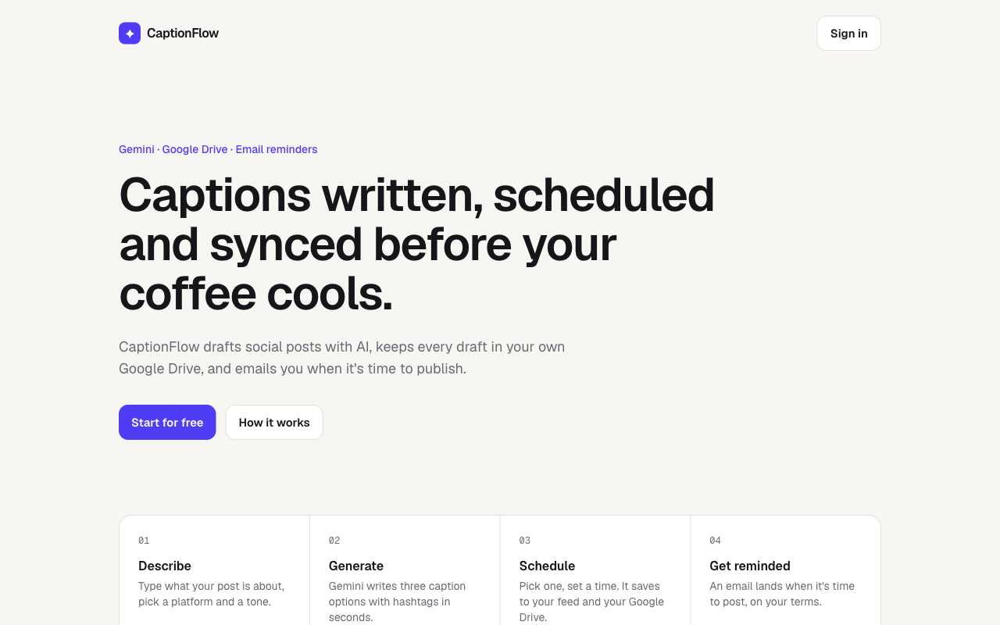
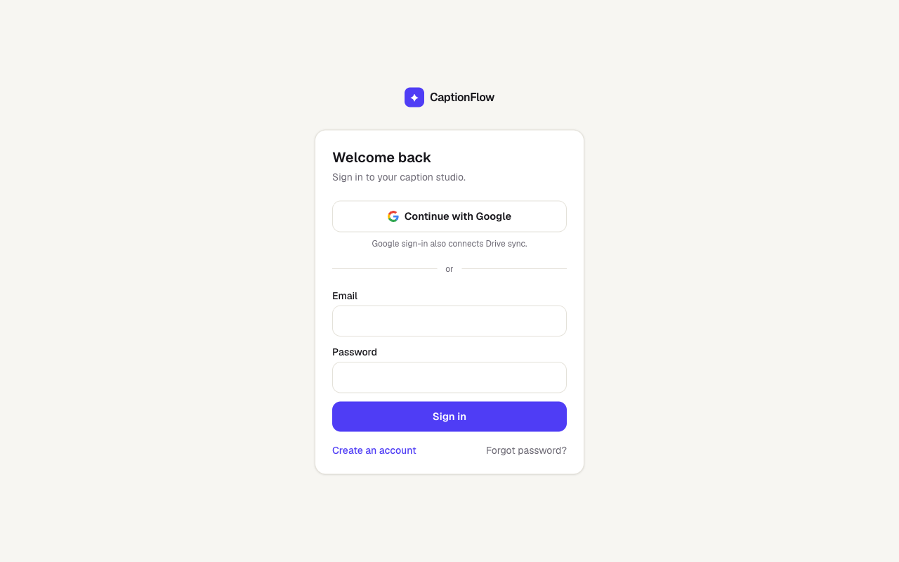
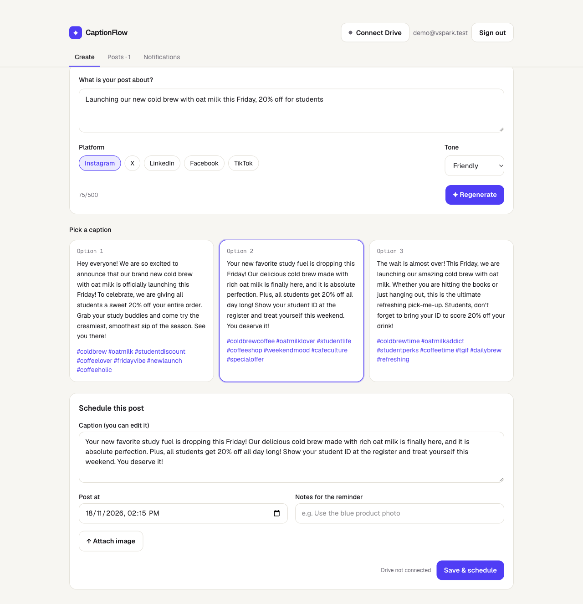
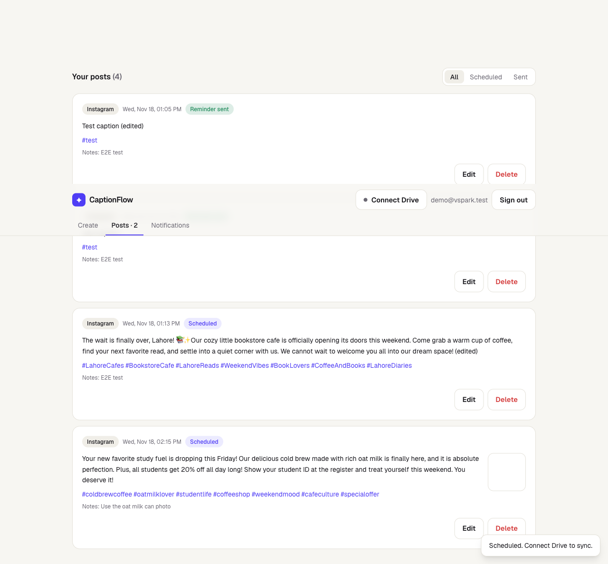
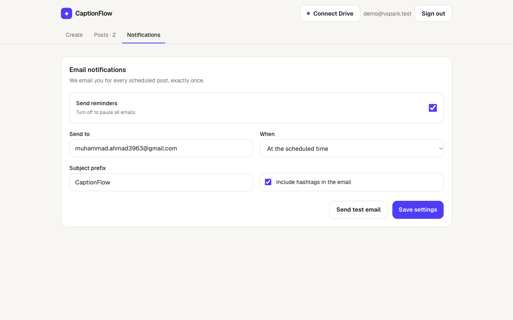
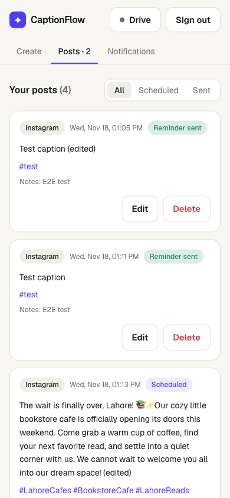

# CaptionFlow — AI Social Media Caption Generator & Scheduler

**Live app:** https://v-spark-2026-beryl.vercel.app
**GitHub:** https://github.com/M-Ahmad069/v-spark-2026

Built for **V-Spark 2026 — Web Development (1-Hour Challenge)**.

| | |
|---|---|
| Student name | _Muhammad Ahmad_ |
| Registration number | _<fill in>_ |
| Team member (if any) | _<fill in>_ |
| Google Drive location | _<fill in organizer folder link>_ |

## What it does

1. **AI caption generator** — describe a post, pick a platform and tone, and Google **Gemini** returns 3 caption options with hashtags.
2. **Google Drive storage & scheduler** — pick a caption, edit it, choose a date/time, add notes and an optional image, then save. The post is stored in the database **and** synced as a JSON file into a `CaptionFlow Posts` folder in the user's own Google Drive.
3. **Feed / list preview** — all saved posts with status (Scheduled / Reminder sent), filters, **edit** (caption, hashtags, time, notes) and **delete** (also removes the Drive file and image).
4. **Email notifications & customization** — an automatic email for every scheduled post. Users choose on/off, recipient address, timing (at the time, 15 min, 1 hour or 1 day before), subject prefix and whether hashtags are included, plus per-post notes. "Send test email" checks delivery instantly.
5. **Deployment** — live on Vercel.

## Screenshots

| Process | Screenshot |
|---|---|
| Landing page |  |
| Register / sign in (email + Google) |  |
| Generate captions with Gemini, pick one, schedule, attach image |  |
| Feed with edit / delete and status |  |
| Email notification settings |  |
| Mobile (responsive) |  |

## Tech stack

| Area | Technology |
|---|---|
| Framework | Next.js 16 (App Router), React 19, TypeScript (strict) |
| Styling | Tailwind CSS 4, light + dark mode, mobile-first |
| Authentication | **Firebase Authentication** (email/password, Google, password reset) |
| Database | **Supabase Postgres** (`posts`, `notification_settings`) |
| Cloud storage | **Supabase Storage** (private `post-images` bucket, signed URLs) + **Google Drive** (post files) |
| External APIs | **Google Gemini API** (`gemini-3.5-flash-lite`), **Google Drive API v3**, Gmail SMTP |
| Scheduler | Supabase `pg_cron` + `pg_net` → `/api/cron` every minute |
| Validation | Zod (every API input and the Gemini output) |
| Hosting | Vercel |

## Architecture

```
Browser (Next.js client)
  │  Firebase sign-in ──► Firebase Auth ──► ID token
  │  POST /api/session  ──► server verifies token signature (Google JWKS) ──► httpOnly cookie
  │
  ├─ /app (protected by src/proxy.ts — verified token required)
  │
  └─ /api/*  (every route re-verifies the session)
        ├─ /api/captions      ──► Gemini API (structured JSON output)
        ├─ /api/posts[/id]    ──► Supabase Postgres (CRUD, scoped to owner)  ──► Google Drive file sync
        ├─ /api/upload        ──► Supabase Storage (private bucket)
        ├─ /api/settings      ──► notification settings + test email (Gmail SMTP)
        └─ /api/cron          ◄── Supabase pg_cron every minute (Bearer CRON_SECRET) ──► due emails
```

## Security

- Server-side session: Firebase ID token signature, issuer, audience and expiry verified on every request; stored only in an `httpOnly`, `Secure`, `SameSite=Lax` cookie.
- Protected routes: `src/proxy.ts` redirects signed-out users from `/app`; all API routes return 401 without a valid session.
- Database: Supabase is only accessed from the server. **RLS is enabled with no public policies**, so the public key can read or write nothing. Every query is filtered by `owner_id`.
- Uploads: max 5 MB, real file signature checked (JPG/PNG/WebP only), random file names under the user's folder, private bucket, 1-hour signed URLs.
- Google Drive uses the narrow `drive.file` scope (the app can only see files it created). The access token stays in the browser tab and is never stored.
- Input validation with Zod, length limits, rate limits on AI, uploads and emails, HTML escaping in emails, prompt-injection guard in the Gemini instruction.
- Cron endpoint protected by a secret (constant-time compare) kept in Supabase Vault; emails are claimed before sending so none are sent twice.
- Security headers (HSTS, X-Frame-Options, nosniff, Referrer-Policy, Permissions-Policy). No secrets in the repo (`.env*` ignored).

## Run locally

```bash
git clone https://github.com/M-Ahmad069/v-spark-2026.git
cd v-spark-2026
npm install
cp .env.example .env.local   # fill in the values below
npm run dev                  # http://localhost:3000
```

### Environment variables

| Name | Where it is used |
|---|---|
| `NEXT_PUBLIC_FIREBASE_API_KEY`, `NEXT_PUBLIC_FIREBASE_AUTH_DOMAIN`, `NEXT_PUBLIC_FIREBASE_PROJECT_ID`, `NEXT_PUBLIC_FIREBASE_APP_ID` | Firebase web app config (public by design) |
| `SUPABASE_URL`, `SUPABASE_SECRET_KEY` | Server-only database + storage access |
| `GEMINI_API_KEY`, `GEMINI_MODEL` (optional) | Caption generation |
| `GMAIL_USER`, `GMAIL_APP_PASSWORD` | Sending notification emails |
| `CRON_SECRET` | Authenticates Supabase pg_cron calls to `/api/cron` |

### Setup steps

1. **Firebase:** create a project → Authentication → enable Email/Password and Google. Add your Vercel domain to *Authorized domains*.
2. **Google Cloud (same project):** enable *Generative Language API* and *Google Drive API*; create an API key for Gemini.
3. **Supabase:** create a project and run the SQL in `supabase/migrations/` (tables, RLS, private bucket, cron). Store the cron secret with `select vault.create_secret('<CRON_SECRET>', 'cron_secret');`.
4. **Gmail:** turn on 2-Step Verification and create an *App password*.
5. **Vercel:** import the GitHub repo, add the environment variables above, deploy.

## Project structure

```
src/
  app/            pages (/, /login, /app) and API routes (/api/*)
  components/     composer, post list, settings panel, UI helpers
  lib/schemas.ts  shared Zod schemas and types
  lib/client/     Firebase client, API helper, Drive token, time helpers
  lib/server/     auth, database, Gemini, Drive, email, HTTP helpers (server-only)
  proxy.ts        protected-route guard
supabase/migrations/   database schema, RLS, storage bucket, cron job
docs/             plan and screenshots
```
